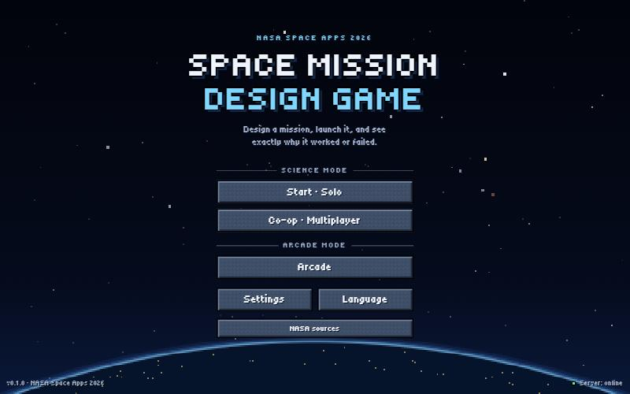
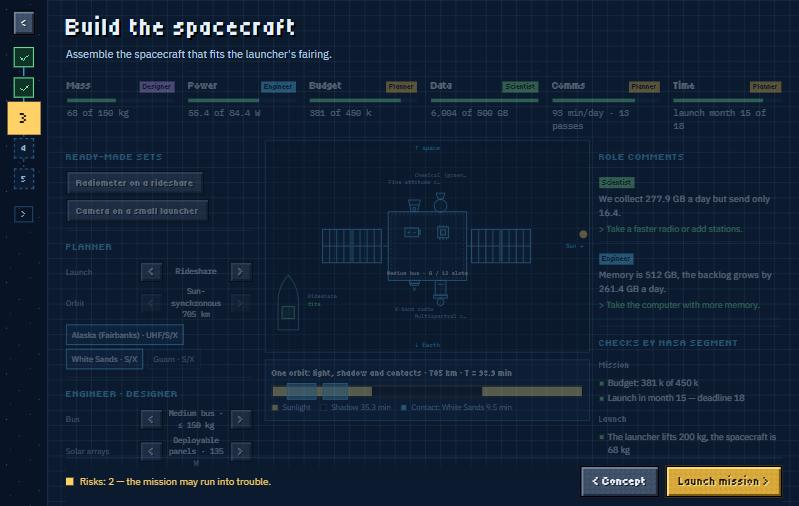
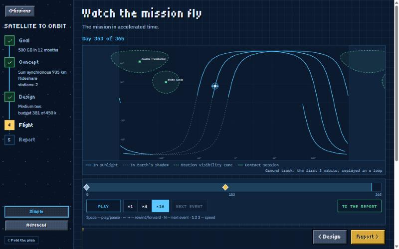
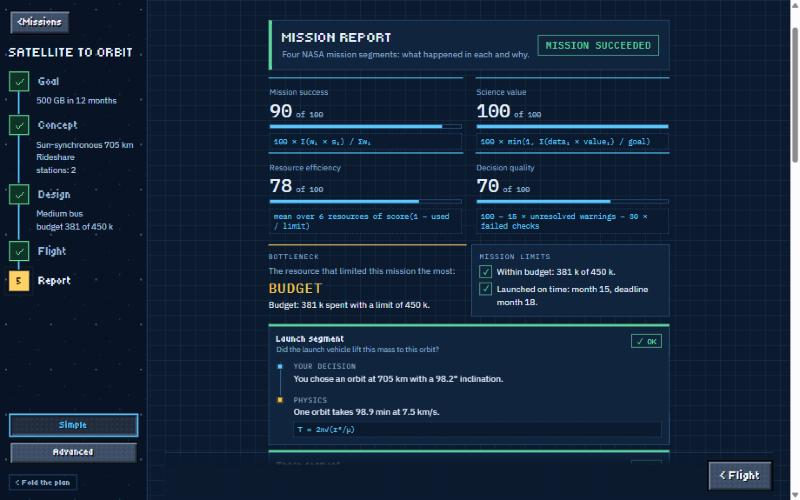
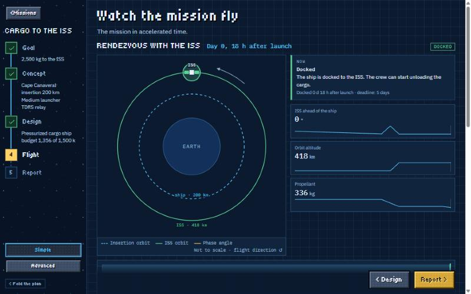

# Space Mission Design Game

**Play it in the browser: <https://shelbythx.github.io/space-game/>** — no sign-in, no install.

Our team's entry for the **NASA Space Apps Challenge 2026** (14–15 November 2026), challenge
[**Space Mission Design Game**](https://www.spaceappschallenge.org/2026/challenges/space-mission-design-game/).

> You get only a goal — *"deliver 500 GB of Earth images within 12 months on a 450k budget"*.
> You choose the orbit, the launcher and the ground stations, build the spacecraft part by part
> and launch it. A simulation built on NASA physics flies the mission and then explains
> **where and why** it worked or broke.

Students meet orbits, rockets and spacecraft as separate school topics and rarely see how they
pull on each other inside one mission. This game is a sandbox for exactly that. Every decision
costs something somewhere else, six limited resources stay on screen the whole time, and a
failed mission explains itself — so you change one thing and fly again.

**Who it is for:** high-school and university students (about 14–22) with no space-engineering
background. **Languages:** English and Ukrainian.

| Main menu | Design: build the spacecraft |
| --- | --- |
|  |  |
| **Flight on the Earth map** | **Report: why it worked or failed** |
|  |  |
| **Cargo to the ISS: the chase and docking** | |
|  | |

<sub>Screenshots from the live game in English: the first four from Mission 1 "Satellite to
orbit", the last one from Mission 2 "Cargo to the ISS".</sub>

## Three missions

| Mission | Goal | Limits | What it teaches |
| --- | --- | --- | --- |
| **Training: your first CubeSat** | 1 GB of measurements in 6 months | 150k budget, launch by month 12 | A CubeSat released from the ISS at 415 km, no engine: air drag slowly brings it down. Step-by-step hints and terms. |
| **Mission 1: Satellite to orbit** | 500 GB of Earth images in 12 months | 450k budget, launch by month 18 | Orbit choice, power in Earth's shadow, how much data the radio and the stations can bring down, the 25-year disposal rule. |
| **Mission 2: Cargo to the ISS** | 2,500 kg to the station, at least 30% science, docking within 5 days | 1,500k budget, launch by month 18 | Launch-site latitude, Hohmann transfer and phasing to catch the station, propellant, relay satellites vs ground stations. |

Each mission comes in two versions. In the **simple** one the roles give advice and parts switch
with `<` `>` buttons. In the **advanced** one the roles state facts only, you set the layout and
the mass margin yourself, and every resource opens a calculation sheet with the formula, the
numbers and the NASA document it comes from.

## How a mission goes

The game follows the NASA mission life cycle in five stages:

1. **Goal** — the need, the end product and the limits (budget, launch deadline, NASA mass
   margin), and which role owns which decision.
2. **Concept** — orbit, launcher and ground stations (or the TDRS relay for the ISS mission),
   with what each choice means: period, time in shadow, lifetime, contact time.
3. **Design** — build the spacecraft on a blueprint: bus, solar arrays, battery, radio,
   computer, attitude control, engine, instruments or cargo. Six resources update after every
   change — **mass, power, budget, data, comms, time** — and the checks are grouped by the four
   NASA mission segments.
4. **Flight** — the backend flies the whole mission and the game replays it in accelerated time
   on a flat Earth map: ground track, Earth's shadow, station visibility, contact sessions,
   battery, stored and delivered data, altitude, propellant and events. For the ISS mission a
   two-orbit view shows the chase and the docking first.
5. **Report** — what happened in each NASA segment (launch, space, ground, user) as a chain
   *your decision → physics → result*, the **bottleneck** resource, four scores with their
   formulas, a comparison with a similar real NASA mission or a reference design, and a
   comparison with your previous attempt. From here you return to any stage, change the design
   and fly again.

**The mission flies only on your decisions.** A new game starts with no instruments, cargo or
ground stations; *Start mission* stays locked until every check passes, and the flight and the
report open only for the design you launched. Change the design afterwards and you have to
launch again.

### Four roles, one spacecraft

Every decision has exactly one owner, and the roles collide through shared resources:

- **Planner** — orbit, launcher, ground stations; answers for budget, comms and schedule.
- **Scientist** — instruments or cargo; answers for the science that reaches the user.
- **Engineer** — solar arrays, battery, radio, computer, attitude control, engine; answers for
  power and propellant.
- **Designer** — the bus, which side each part faces, the mass margin; answers for mass and the
  fit in the fairing.

There is no single right answer. A cheap rideshare forces modest parts; the best camera collects
more data than the radio can send down; the best parts together do not fit the budget with a
small launcher.

### Random events, real and seeded

- **Real space weather.** Geomagnetic storms come from **NASA DONKI** (a real year of storms
  replayed on your mission); the report shows each storm's date and Kp index. A storm costs
  ground contacts.
- **Seeded events** — debris avoidance, part failures. The same design and the same flight seed
  always give the same flight; *Fly again* picks a new seed.

## NASA data and sources

The backend computes everything; the browser only shows it. Each formula and constant has a NASA
source with section and page in [`docs/physics-sources.md`](docs/physics-sources.md). Derived
formulas and game estimates (prices, instrument data rates) are marked as such in the game. All
source links and the key numbers were checked against the documents on 15.11.2026
([`tasks/040-docs-nasa-links.md`](tasks/040-docs-nasa-links.md)).

- **Small Spacecraft Technology State-of-the-Art 2026** (NASA SmallSat Institute) — solar
  arrays, batteries, engines, attitude control and computers in the parts catalog
  ([`docs/catalogs.md`](docs/catalogs.md)).
- **NASA DONKI** (api.nasa.gov) — real historical geomagnetic storms.
- **GSFC-STD-1000 "Gold Rules"** (NASA Goddard) — mass and power margins in the checks.
- **NASA-STD-8719.14C** — the 25-year limit for leaving orbit after the mission.
- **Earth Fact Sheet** (NSSDCA), **GMAT Mathematical Specifications**, **U.S. Standard
  Atmosphere 1976**, Rickman's *Introduction to Orbital Mechanics and Spacecraft Attitudes for
  Thermal Engineers* — orbit period, Earth's shadow, ground track, drag and orbit decay, Hohmann
  transfer, phasing.
- **Ideal Rocket Equation** and **Drag Equation** (NASA Glenn, Beginner's Guide to
  Aeronautics) — propellant and drag.
- **Near Earth Network Users' Guide**, **Near Space Network** and **TDRS** pages — ground
  stations, elevation mask, relay coverage.
- **ISS resupply missions** (SpaceX CRS-29, Northrop Grumman NG-20, Orb-2 press kit, ISS
  trajectory data) — cargo masses, science share, launch sites
  ([`docs/catalogs-iss.md`](docs/catalogs-iss.md)).
- **Similar missions library** — 11 real NASA missions (Landsat 9, Aqua, PACE, ICESat-2,
  GOES-16, TDRS-M, TROPICS, IceCube, Dellingr, CRS-29, NG-20) with sources, plus 13 reference
  designs run through our simulation ([`docs/reference-missions.md`](docs/reference-missions.md)).
- **NASA Image and Video Library** — photos for our submission materials in `assets/images/`;
  each one is listed with its NASA ID in [`assets/CREDITS.md`](assets/CREDITS.md).

The NASA logo and insignia are not used.

## How it answers the challenge

| The challenge asks for | In the game |
| --- | --- |
| The full path: goal → requirements → spacecraft → instruments → launcher and orbit → flight → evaluation | Five stages, the same in all three missions |
| Limited resources shown explicitly | Six resource bars on the blueprint, gauges during the flight |
| Every decision has a consequence; no single perfect answer | Each part changes several resources; many designs reach the same goal |
| Mass and orbit must fit the launcher | Launch checks: capacity to the chosen orbit, bus size vs fairing |
| Explain why a decision affected the result | Cause-and-effect chains with formulas and the bottleneck in the report |
| Scores | Mission success, science value, resource efficiency, decision quality — formula next to each |
| Change and run again; save and compare | Return to any stage; attempts saved on the server and compared; same seed, same flight |
| Random events | Real DONKI storms, debris avoidance, part failures, orbit decay |
| Different difficulty levels and scenarios | Training CubeSat, satellite to orbit, ISS cargo; simple and advanced versions |
| Up to four players with roles | Four roles in single player; the co-op mode for 2–4 players is designed, not built (see below) |

### Honest status at the deadline

- **Playable end to end, with the live backend:** all three missions, both versions, all five
  stages.
- **Designed, not built:** co-op for 2–4 players over a local network with one role per player
  ([`docs/decisions.md`](docs/decisions.md), D96–D97), and the Arcade mode. Their menu buttons
  say that they come later.
- **Without the server** the game still opens in *demo mode*, marked on screen: the design
  stages use an approximate in-browser calculation, and the flight and the full report say that
  they need the mission server.

## Run it yourself

The hosted version needs nothing: <https://shelbythx.github.io/space-game/> (frontend on GitHub
Pages, backend on Azure App Service with Azure PostgreSQL, deployed from `main` by GitHub
Actions).

**Backend** — ASP.NET Core on .NET 10 + PostgreSQL 17, with Docker:

```bash
cd backend
docker compose up --build
```

The API listens on <http://localhost:5080> (`GET /api/health`, OpenAPI at `/openapi/v1.json`).
Set `NASA_API_KEY` in `backend/docker-compose.yml` for DONKI, or the public `DEMO_KEY` is used.
Without Docker: .NET 10 SDK and PostgreSQL, see [`backend/README.md`](backend/README.md).

**Frontend** — React + TypeScript + Vite, Node 22+:

```bash
cd frontend
npm install
npm run dev
```

Open <http://localhost:5173> (the backend accepts requests from this address).

## Tech

- **Backend:** C#, ASP.NET Core on .NET 10, EF Core, PostgreSQL 17; xUnit tests. One service
  (modular monolith): catalogs, physics, evaluation, flight simulation, report, attempts, DONKI.
- **Frontend:** React 19, TypeScript, Vite, MUI, i18next (EN/UK), React Router. Pixel menu font
  Tiny5, blueprint in IBM Plex.
- **Contract:** REST/JSON, [`docs/api.md`](docs/api.md) and [`docs/openapi.yaml`](docs/openapi.yaml).
  The backend sends message codes; all player texts live in the frontend translations.
- **CI/CD:** GitHub Actions — frontend build and lint, backend build and tests; a push to `main`
  that changes the frontend or the backend deploys it to GitHub Pages or Azure.

## Repository

| Path | What is there |
| --- | --- |
| `backend/` | The API and its tests |
| `frontend/` | The game: menu, mission stages, blueprint, flight, report |
| `assets/` | Music, NASA photos; origin of every file in [`assets/CREDITS.md`](assets/CREDITS.md) |
| `docs/` | Vision, decision log, API contract, physics sources, catalogs (mostly in Ukrainian) |
| `docs/submission/` | Screenshots and texts for the submission |
| `tasks/` | Development tasks, one file per task, with who did what |

## Team

| | Who | What they built |
| --- | --- | --- |
| [@Shelbythx](https://github.com/Shelbythx) | **Svyatoslav Maliuga** (Stiluss) | Game design and the mission concept; frontend — mission stages, blueprint, training mission, ISS mission screens, texts; the game's original music; NASA source checks |
| [@Khudashchov](https://github.com/Khudashchov) | **Bohdan Khudashchov** | Backend — physics, evaluation, flight simulation, report, NASA DONKI, ISS orbital mechanics, catalogs; hosting on Azure; CI |
| [@TheAdvental](https://github.com/TheAdvental) | **TheAdvental** | Flight replay on the Earth map, report screen, ISS rendezvous view, game audio |
| [@katyashozda](https://github.com/katyashozda) | **katyashozda** | ISS and CubeSat catalogs from NASA sources, similar-missions library checks, NASA images, submission materials |

## Use of AI

We built the project with Claude (Anthropic) coding agents, directed and reviewed by the team
members above. What the agents did, what people did, and how the numbers were checked:
[`docs/ai-usage.md`](docs/ai-usage.md).

## License

Source code: [MIT License](LICENSE). Music in `assets/audio/`: © Stiluss, all rights reserved,
used only as part of this project. Fonts Tiny5 and IBM Plex: SIL Open Font License 1.1. NASA
images: used under the NASA Images and Media Guidelines, credited to NASA, with no implied
endorsement (details in [`assets/CREDITS.md`](assets/CREDITS.md)).
