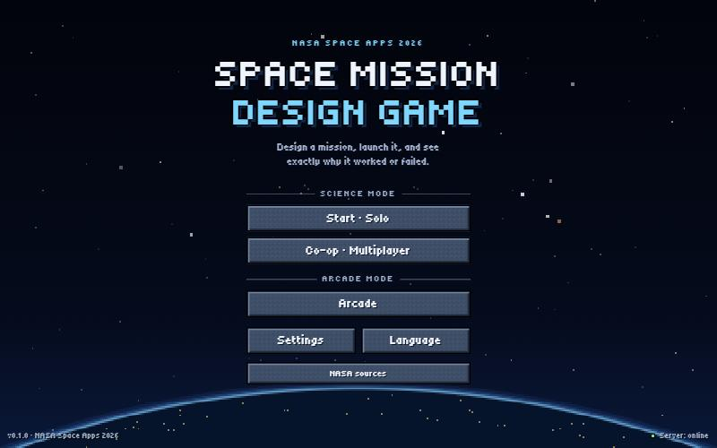
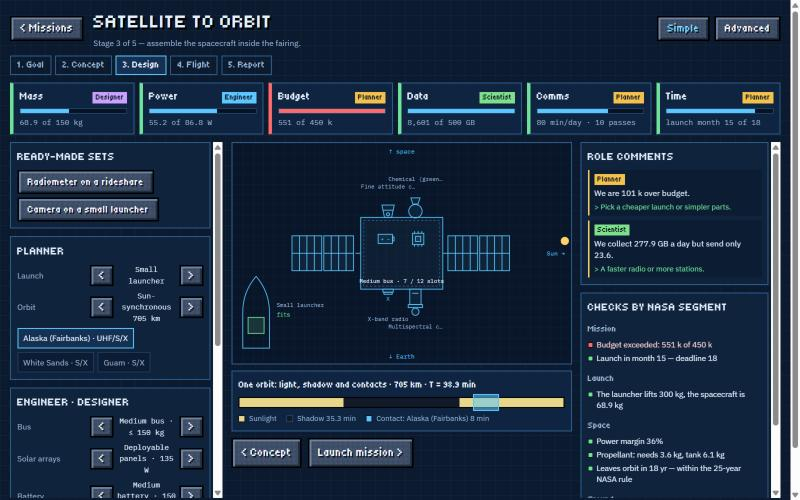
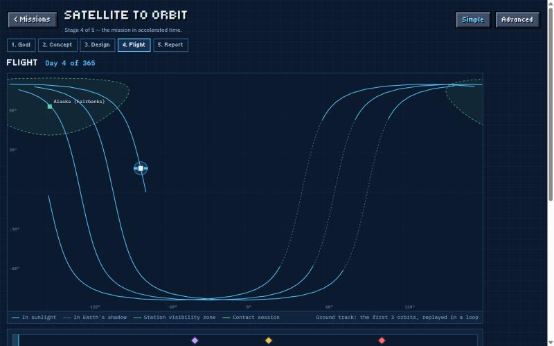
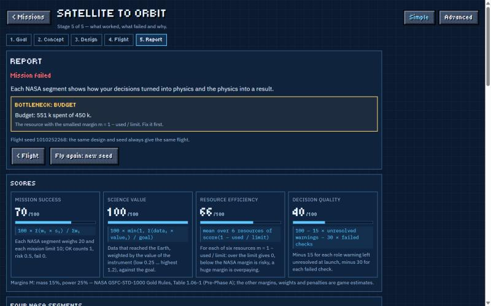

# Space Mission Design Game

**Play in the browser: <https://shelbythx.github.io/space-game/>**

Team entry for the **NASA Space Apps Challenge 2026** (14–15 November 2026), challenge
[**"Space Mission Design Game"**](https://www.spaceappschallenge.org/2026/challenges/space-mission-design-game/).

> **You get only the mission goal** — say, *"deliver 500 GB of Earth images in 12 months
> on a 450k budget"*. You assemble the spacecraft, pick the orbit, the launcher and the
> ground stations, launch the mission — and a simulation built on real physics shows where
> and **why** it worked or broke.

Students learn orbits, rockets and spacecraft as separate topics and rarely see how they
pull on each other inside one mission. This game is a sandbox for exactly that: every
decision costs something somewhere else, the six limited resources are always on screen,
and a failed mission explains itself — so you can fix the design and fly again.

Audience: high-school and university students (14–22) with no space-engineering
background. Languages: English (main) and Ukrainian.

| Main menu | Design: assemble the spacecraft |
| --- | --- |
|  |  |
| **Flight on the Earth map** | **Report: why it worked or failed** |
|  |  |

<sub>Flight and report screenshots were taken with sample data in the shape of the API
contract (the backend was not running on the capture machine); in the game they show the
backend simulation.</sub>

## How a mission goes

The Science mode follows the NASA mission process in five stages:

1. **Goal** — the need, the end product and the limits (budget, launch deadline, NASA mass
   margin).
2. **Concept** — orbit, launcher and ground stations, with what each orbit means (period,
   shadow, lifetime).
3. **Design** — assemble the spacecraft on a blueprint: bus, solar arrays, battery, radio,
   computer, attitude control, engine and instruments. Six resources update after every
   change — **mass, power, budget, data, comms, time** — and four roles comment on it.
4. **Flight** — the mission replayed in accelerated time on a flat map of the Earth:
   ground track, Earth's shadow, station visibility zones, battery, data, altitude and
   propellant, plus events.
5. **Report** — the four NASA segments (launch, space, ground, user) with a causal chain
   *decision → physics → result* for each, the **bottleneck** resource, four scores with
   their formulas, real space-weather events, and a comparison with your previous attempt.
   From here you can return to any stage, change the design and fly again.

### Four roles, one spacecraft

Every decision has exactly one owner, and the roles collide through shared resources:

- **Planner** — orbit, launcher, ground stations; answers for budget, comms and schedule.
- **Scientist** — instruments; answers for the data that reaches the Earth.
- **Engineer** — solar arrays, battery, radio, computer, attitude control, engine; answers
  for power.
- **Designer** — the bus, which side each part faces, the mass margin; answers for mass and
  the fit in the fairing.

Two depths: in the **simple** version the roles give advice and parts switch with `<` `>`
buttons; in the **advanced** version the roles state facts only and every resource has a
calculation sheet with the formula, the numbers and the NASA document it comes from.

There is no single right answer: a cheap rideshare forces modest parts; the best camera
collects more data than the radio can send down; the best parts do not fit the budget
together with a small launcher.

## NASA data and resources

The backend computes everything (the frontend only shows it). Each formula and constant
has a NASA source — the full list with sections and pages is in
[`docs/physics-sources.md`](docs/physics-sources.md); derived formulas and game estimates
are marked as such in the game.

- **NASA DONKI** (api.nasa.gov) — real historical geomagnetic storms are replayed during
  the flight; the report shows each storm's date and Kp index.
- **Small Spacecraft Technology State-of-the-Art 2026** (NASA SmallSat Institute) — solar
  arrays, batteries, radios, engines and other parts in the catalog
  ([`docs/catalogs.md`](docs/catalogs.md)).
- **GSFC-STD-1000 Rev I "Gold Rules"** (NASA Goddard) — mass and power margins used in the
  checks and in the *resource efficiency* score.
- **Earth Fact Sheet** (NSSDCA), **GMAT Mathematical Specifications**, **U.S. Standard
  Atmosphere 1976**, Rickman's *Introduction to Orbital Mechanics and Spacecraft Attitudes
  for Thermal Engineers* — orbit period, Earth's shadow, ground track, drag and orbit decay.
- **Ideal Rocket Equation** and **Drag Equation** (NASA Glenn Beginner's Guide to
  Aeronautics) — propellant and drag.
- **NASA-STD-8719.14C** — the 25-year rule for leaving orbit after the mission.
- **Near Earth Network Users' Guide** and **Near Space Network** — ground stations and their
  elevation mask.
- **Design and Develop a Science Mission** (NASA) — the four mission segments that shape
  the roles and the report; **Catalog of Earth Satellite Orbits** (NASA Earth Observatory) —
  the orbit choices.

The NASA logo and insignia are not used.

## Run it locally

The hosted version is at <https://shelbythx.github.io/space-game/> (frontend on GitHub
Pages, backend on Azure App Service with Azure PostgreSQL). To run it on your machine:

**1. Backend** (ASP.NET Core on .NET 10 + PostgreSQL 17), with Docker:

```bash
cd backend
docker compose up --build
```

The API listens on <http://localhost:5080> (`GET /api/health`, OpenAPI at
`/openapi/v1.json`). Optional: set `NASA_API_KEY` in `backend/docker-compose.yml` for
DONKI; without it the public `DEMO_KEY` is used. Without Docker: .NET 10 SDK and
PostgreSQL — see [`backend/README.md`](backend/README.md).

**2. Frontend** (React + TypeScript + Vite), Node 22+:

```bash
cd frontend
npm install
npm run dev
```

Open <http://localhost:5173>. The backend allows requests from this address only, so keep
port 5173 free.

**Without the backend** the game still starts in *demo mode*, marked on screen as "Demo
calculation": the mission design works with an approximate in-browser calculation, while
the flight and the full report say that they need the mission server.

## How it answers the challenge

| The challenge asks for | In the game |
| --- | --- |
| The full mission path: goal → requirements → spacecraft → instruments → launcher and orbit → flight → evaluation | Five stages of the Science mode |
| Limited resources shown explicitly | Six resource bars on the blueprint and gauges in the flight |
| Every decision has a consequence; no single perfect solution | Every part changes several resources; many designs reach the same goal |
| Compatibility of mass and orbit with the launcher | Launch checks: capacity to the chosen orbit, bus size vs fairing |
| Explain why a decision affected the result | Causal chains with formulas and the bottleneck in the report |
| Scores | Mission success, science value, resource efficiency, decision quality — formula shown next to each |
| Change and run again; save and compare | Return to any stage; attempts saved and compared; the same seed replays the same flight |
| Random events | Real DONKI storms, debris avoidance, part failures, orbit decay |
| Different difficulty levels and scenarios | Simple and advanced versions; a CubeSat training mission and an ISS cargo mission in the backend |
| Up to four players with roles | Four roles in single player; the LAN co-op mode is designed (see below) |

### Honest status at the deadline

- **Playable end to end:** Mission 1 "Satellite to orbit" — goal, concept, design, flight,
  report.
- **Backend ready, screens pending:** the ISS cargo mission (launch-site latitude, Hohmann
  transfer, phasing, docking) and the CubeSat training mission.
- **Designed, not implemented:** co-op for 2–4 players over a local network, one role per
  player, changes accepted only from the role's owner
  ([`docs/decisions.md`](docs/decisions.md), D96–D97); Arcade mode.
- The library of similar missions is ready — 11 real NASA missions with sources and 13
  reference designs ([`docs/reference-missions.md`](docs/reference-missions.md)); showing the
  closest one in the report is in progress.

## Tech

- **Backend:** C#, ASP.NET Core on .NET 10, PostgreSQL 17, EF Core; xUnit tests. One
  service (modular monolith).
- **Frontend:** React 19, TypeScript, Vite, MUI, i18next (EN/UK), React Router; pixel-art
  menu font Tiny5, blueprint theme in IBM Plex.
- **Contract:** REST/JSON in [`docs/api.md`](docs/api.md) and
  [`docs/openapi.yaml`](docs/openapi.yaml). All player texts are message codes translated
  on the frontend.
- **CI:** GitHub Actions — frontend build and lint, backend build and tests.

## Repository

| Path | What is there |
| --- | --- |
| `backend/` | API: catalogs, physics, evaluation, simulation, report, attempts, DONKI |
| `frontend/` | The game: menu, mission stages, blueprint, flight, report |
| `assets/` | Music by the team; origin of every file in [`assets/CREDITS.md`](assets/CREDITS.md) |
| `docs/` | Vision, decision log, API contract, physics sources, catalogs (mostly in Ukrainian) |
| `docs/submission/` | Screenshots, form texts and slide texts for the submission |
| `tasks/` | Development tasks, one file per task |

## Use of AI

The team built this project with Claude (Anthropic) coding agents directed and reviewed
by team members. Details — what the agents did, what people did, and how numbers were
checked — are in [`docs/ai-usage.md`](docs/ai-usage.md).

## License

The source code is under the [MIT License](LICENSE). The music in `assets/audio/` is
© Stiluss, all rights reserved; it may be used only as part of this project (see
[`assets/CREDITS.md`](assets/CREDITS.md)). Fonts: Tiny5 and IBM Plex — SIL Open Font
License 1.1.

## Team

- **Stiluss** ([@Shelbythx](https://github.com/Shelbythx)) — game design, frontend, music.
- **Khudashchov** — backend, physics, hosting.
- **TheAdvental** — flight screen.
- **katyashozda** — API contract, similar-missions library, submission materials.
